# Automotive Power MOSFET – Electrical & Thermal Analysis

MATLAB-based investigation of conduction losses, temperature-dependent on-state resistance, datasheet-based curve fitting, and simplified steady-state electrothermal feedback in an automotive power MOSFET.

## 1. Project Overview

This project explores how drain current, junction temperature, and thermal resistance influence conduction losses in power MOSFETs. It progresses from simple illustrative models to approximate manufacturer-curve fitting and a coupled electrothermal calculation.

**Component reference:** Infineon IAUC100N08S5N034 automotive MOSFET.

The analyses are educational models, not a validated device design or experimental characterization. Datasheet curve points were read approximately from a published graph, not supplied as tabulated manufacturer measurements.

## 2. Mathematical Models

### Conduction loss

**P_cond = I_D² × R_DS(on)**

- `P_cond`: conduction loss [W]
- `I_D`: drain current [A]
- `R_DS(on)`: on-state resistance [Ω]

This expression assumes constant DC current and continuous conduction. For time-varying current, losses require an appropriate time average.

### Temperature-dependent resistance

**Linear:** `R(T) = R_ref × [1 + α × (T − T_ref)]`

**Exponential:** `R(T) = R_ref × (1 + α)^(T − T_ref)`

- `T`: junction temperature [°C]
- `T_ref`: reference temperature (25 °C)
- `R_ref`: resistance at reference temperature
- `α`: model coefficient [K⁻¹]

The initial comparisons use an **assumed** `α = 0.004 K⁻¹`. Subsequent fitting estimates coefficients from approximately read datasheet points.

### Simplified steady-state electrothermal model

**T_j = T_a + P_cond(T_j) × R_thJA**

- `T_j`: junction temperature [°C]
- `T_a`: ambient temperature [°C]
- `R_thJA`: junction-to-ambient thermal resistance [K/W]

Because `P_cond` depends on `T_j`, the equation is solved iteratively. The thermal model represents a particular PCB/ambient condition, not an arbitrary automotive cooling assembly.

## 3. Simulation Results

### 3.1 Conduction Loss vs Drain Current — Initial Model

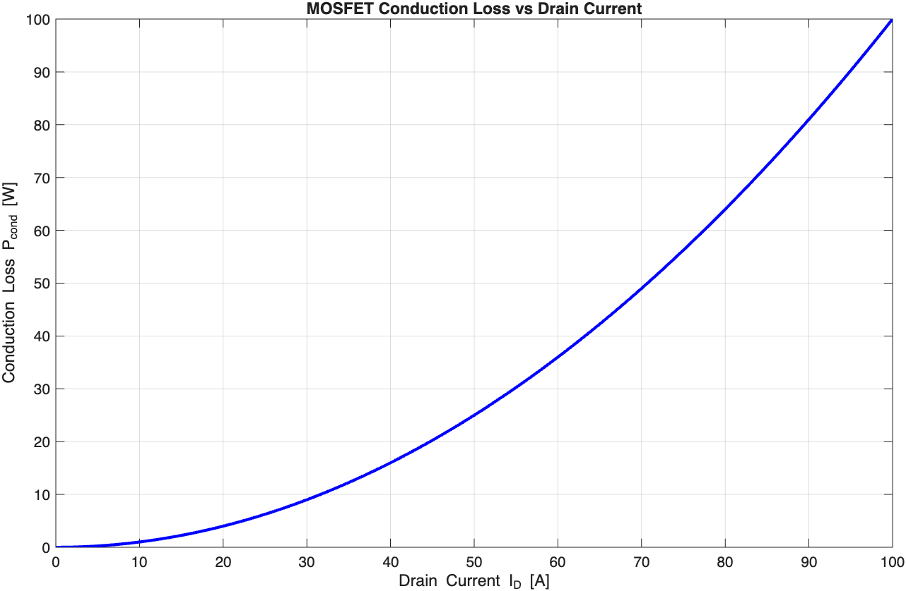

A constant 10 mΩ on-state resistance illustrates the quadratic dependence of conduction loss on current: doubling current increases loss fourfold when resistance is unchanged.

### 3.2 Conduction Loss vs Temperature — Initial Model

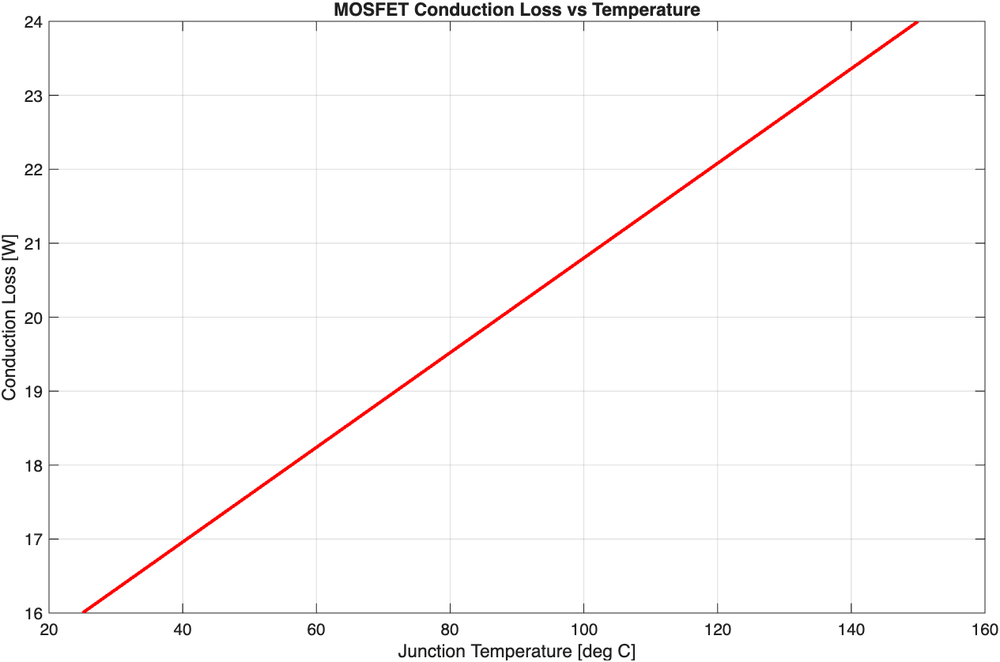

With an illustrative 10 mΩ resistance at 25 °C, `α = 0.004 K⁻¹`, and 40 A DC current, the linear model predicts a rise from 16 W at 25 °C to 24 W at 150 °C.

### 3.3 Component-Reference Resistance Comparison

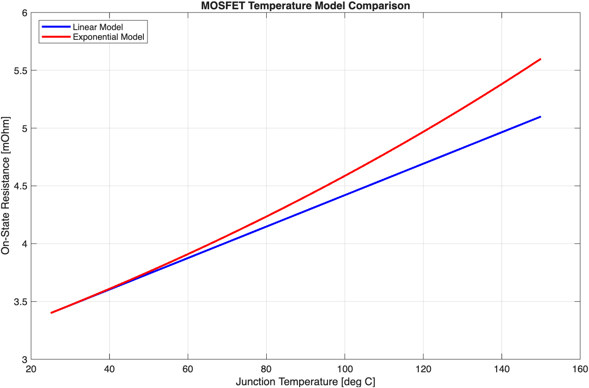

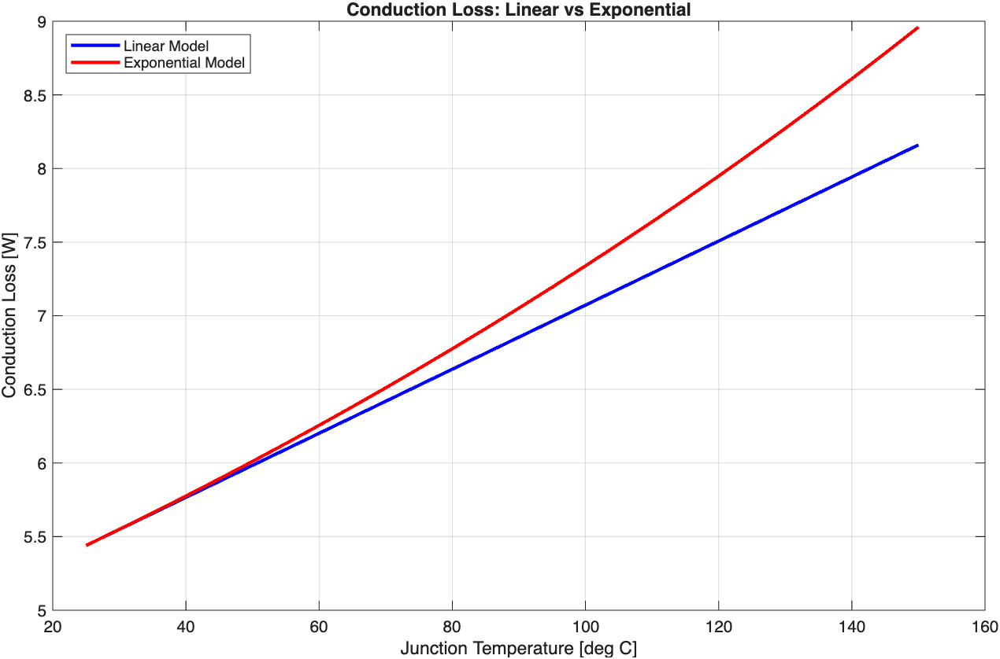

This preliminary analysis uses **3.4 mΩ**, a specified **maximum** on-state resistance at the relevant datasheet test condition, with the illustrative `α = 0.004 K⁻¹`. At 40 A and 150 °C:

| Model | Resistance | Conduction loss |
|---|---:|---:|
| Linear | 5.10 mΩ | 8.16 W |
| Exponential | ~5.60 mΩ | ~8.96 W |

These are illustrative extrapolations from the selected reference value, not manufacturer-certified temperature-dependent maximum resistance limits.

### 3.4 Approximate Datasheet Curve Extraction

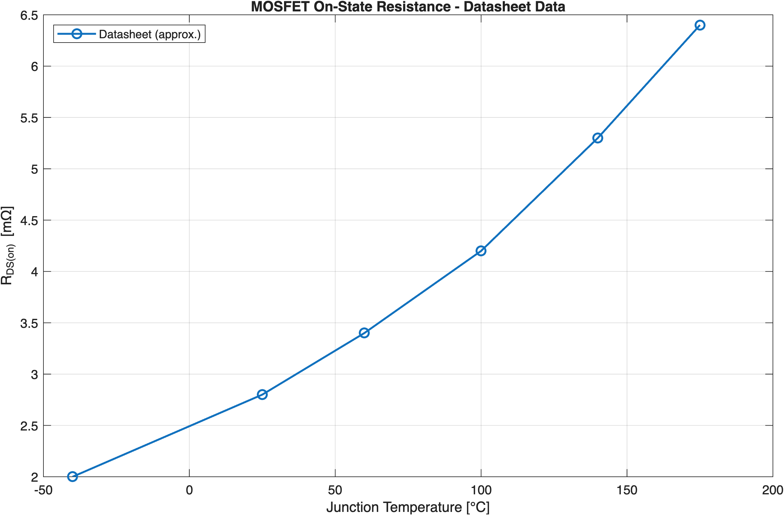

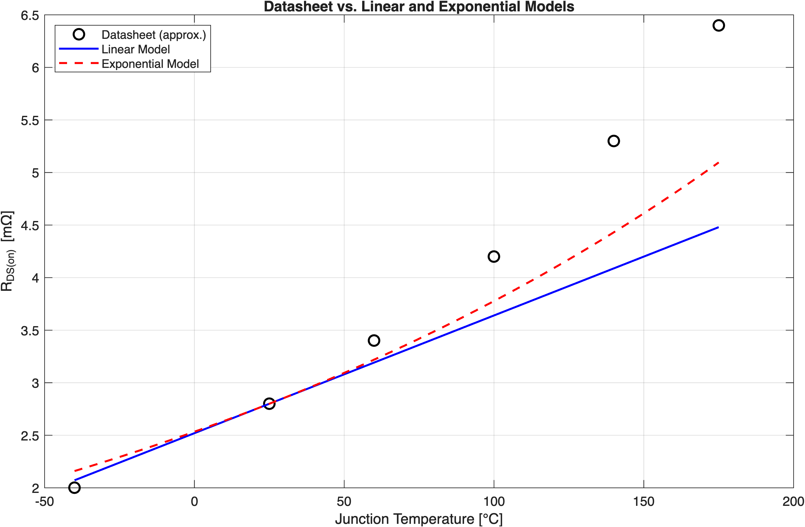

Six resistance points were **estimated visually** from the manufacturer's *typical drain-source on-state resistance* graph for **V_GS = 10 V, I_D = 50 A**:

| Junction temperature | Approximate typical R_DS(on) |
|---:|---:|
| −40 °C | 2.0 mΩ |
| 25 °C | 2.8 mΩ |
| 60 °C | 3.4 mΩ |
| 100 °C | 4.2 mΩ |
| 140 °C | 5.3 mΩ |
| 175 °C | 6.4 mΩ |

For this comparison, **2.8 mΩ typical at 25 °C** is used as `R_ref`, rather than the 3.4 mΩ maximum used in the earlier illustrative analysis. These two values describe different statistical specifications and must not be interchanged.

### 3.5 Model Fitting and Error Analysis

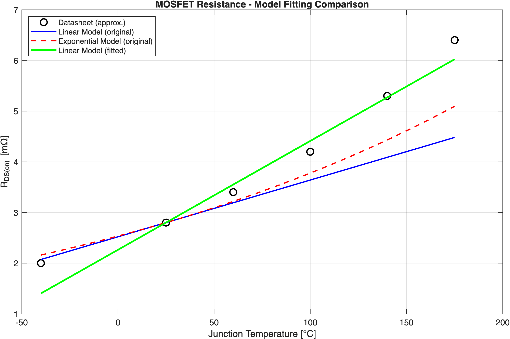

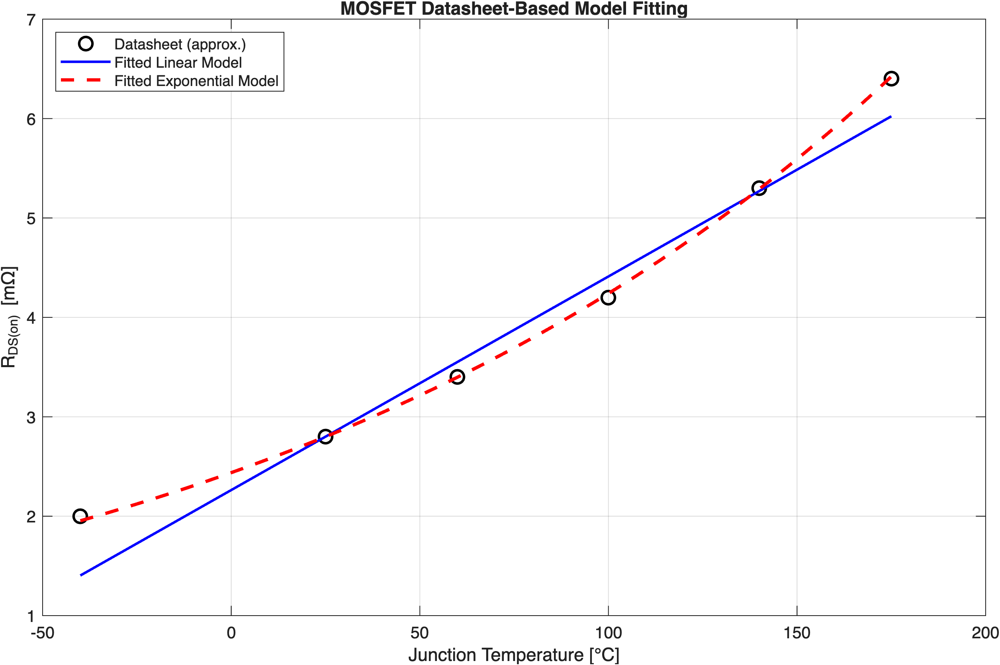

The linear coefficient is estimated analytically using least squares. The exponential coefficient is fitted numerically using MATLAB `fminsearch` to minimize the sum of squared resistance errors.

| Model | MAE [mΩ] | RMSE [mΩ] |
|---|---:|---:|
| Linear, α = 0.004 | 0.6620 | 0.9589 |
| Exponential, α = 0.004 | 0.4893 | 0.6698 |
| Fitted linear | 0.2277 | 0.3074 |
| Fitted exponential | **0.0199** | **0.0269** |

- Fitted linear coefficient: approximately **0.007673 K⁻¹**.
- Fitted exponential coefficient: approximately **0.005550 K⁻¹**.
- Fitted exponential model: **R(T) = 2.8 × (1.005550)^(T − 25) mΩ**.

The fitted exponential model has the smallest *in-sample* error for these six approximate graph readings. This is **curve fitting**, not independent model validation; the result may be sensitive to digitization uncertainty and should not be interpreted as an experimentally verified device law.

### 3.6 Temperature-Dependent Conduction Loss

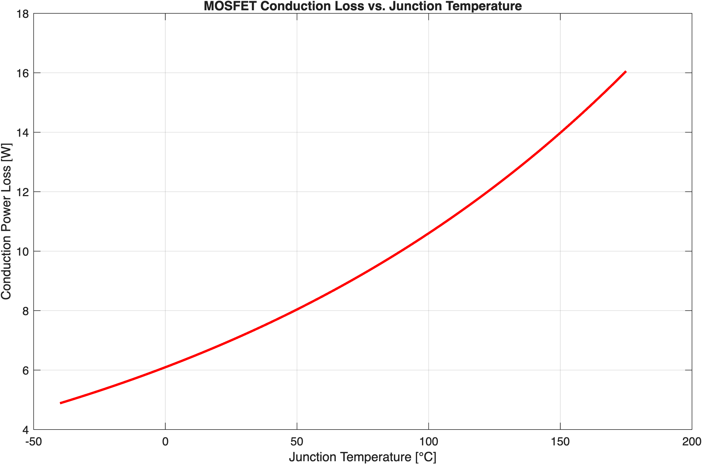

Using the fitted exponential resistance model and a constant 50 A DC current, conduction loss increases from approximately **7 W at 25 °C** to **16 W at 175 °C**. This plot treats junction temperature as an input and does not calculate the temperature reached under that load.

### 3.7 Simplified Electrothermal Feedback

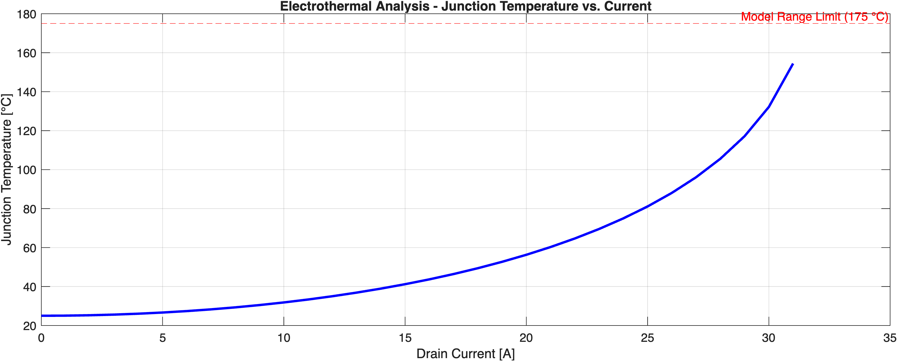

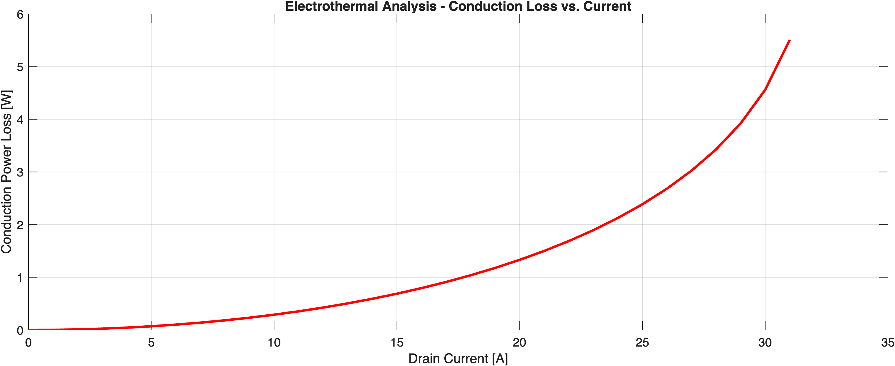

A steady-state fixed-point iteration couples conduction loss to junction temperature:

| Parameter | Value |
|---|---:|
| Ambient temperature | 25 °C |
| Gate voltage condition for resistance fit | 10 V |
| Reference typical on-state resistance | 2.8 mΩ at 25 °C |
| Fitted exponential coefficient | ~0.005550 K⁻¹ |
| Junction-to-ambient thermal resistance | 23.5 K/W |
| Current sweep | 0–50 A |
| Upper temperature bound of fitted curve | 175 °C |

The **23.5 K/W** value is the manufacturer's junction-to-ambient thermal resistance for a specified **four-layer 2s2p FR4 reference PCB, mounted vertically in still air**. It is not generally transferable to other PCB layouts or cooling arrangements. The datasheet also lists junction-to-case thermal resistance, which is **not** interchangeable with junction-to-ambient resistance.

At **10 A**, the iterative model converges to approximately **31.83 °C** junction temperature and **0.2908 W** conduction loss, starting from a 25 °C ambient.

The current-sweep code records a result only when its fixed-point iteration converges within the selected tolerance and the predicted temperature remains at or below **175 °C**. The plotted curve ends near **31 A** under these particular assumptions. **This endpoint is not a rated maximum current, a safe-operating-area boundary, or proof of thermal stability at higher currents.** The 175 °C threshold here bounds the extracted resistance-curve data; it should not automatically be interpreted as the device's absolute maximum junction temperature.

## 4. MATLAB Files

| File | Purpose |
|---|---|
| `mosfet_conduction_analysis.m` | Initial current-dependent and temperature-dependent conduction loss examples using an illustrative 10 mΩ reference resistance |
| `mosfet_datasheet_analysis.m` | Linear and exponential temperature-model comparison using a 3.4 mΩ component-reference maximum resistance |
| `mosfet_datasheet_validation.m` | Approximate datasheet-point extraction, model comparisons, MAE/RMSE, linear and exponential coefficient fitting, and temperature-dependent conduction loss |
| `mosfet_electrothermal_analysis.m` | Iterative steady-state electrothermal calculation and current sweeps for junction temperature and conduction loss |

Run each MATLAB script from the repository directory to reproduce its corresponding figures. The scripts use standard MATLAB functions, including `fminsearch` for parameter fitting.

## 5. Tools and Technologies

- MATLAB
- Git and GitHub
- Power semiconductor and MOSFET fundamentals
- Conduction-loss and temperature-dependent resistance modeling
- Least-squares parameter fitting and numerical optimization
- Simplified steady-state electrothermal analysis

## 6. Assumptions and Limitations

- Models assume an appropriately enhanced MOSFET and the stated gate-voltage conditions; actual resistance depends on operating conditions and device variation.
- Current is treated as constant DC, and only conduction losses are modeled. Switching, gate-drive, and other losses are excluded.
- Datasheet resistance points were estimated from a plotted *typical* characteristic, not extracted from a manufacturer's numerical dataset or measured experimentally.
- Curve-fitting errors are calculated on the same six points used for fitting; no independent validation dataset is available.
- The initial 3.4 mΩ maximum-resistance examples and the later 2.8 mΩ typical-resistance fitting use different reference specifications.
- The electrothermal calculation assumes a constant ambient temperature, constant junction-to-ambient thermal resistance, and a lumped steady-state thermal path. It does not simulate thermal transients, spatial temperature gradients, or realistic automotive cooling hardware.
- The current sweep uses a fixed-point convergence test and a 175 °C resistance-data range limit. A missing plotted point does not, by itself, establish device failure or instability.
- Safe operating area, absolute maximum ratings, package/PCB current limits, and real design margins are not established by this project.
- All results are analytical/numerical estimates rather than experimental measurements.

## 7. Future Development

1. Digitize more points from the manufacturer curve and quantify reading uncertainty.
2. Test fitted models on independent points or laboratory measurements.
3. Evaluate different PCB cooling conditions and thermal resistances.
4. Add transient thermal impedance and time-varying load profiles.
5. Include switching losses and check relevant device operating limits.

## 8. References

Infineon Technologies, **IAUC100N08S5N034 Automotive Power MOSFET**:

- [Product page](https://www.infineon.com/part/IAUC100N08S5N034)
- Manufacturer datasheet: typical on-state resistance vs. junction temperature and thermal characteristics, including the junction-to-ambient reference-PCB footnote.

---

**Project status:** Work in progress — initial models, approximate datasheet-based curve fitting, and simplified steady-state electrothermal analysis implemented.
